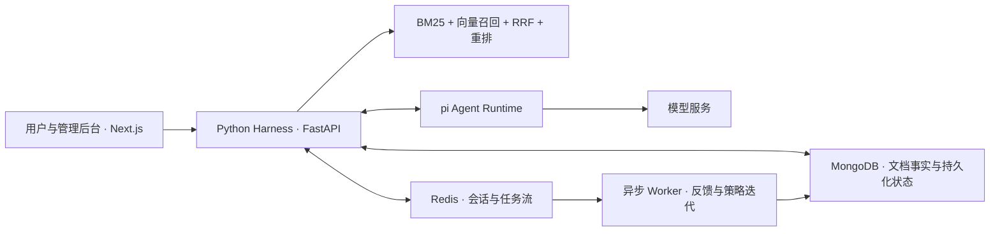

# 智能客服

**面向电商业务的可信 RAG 与 Agent 反馈迭代系统。**

这是我完成的电商客服知识问答项目。我围绕比价导购、二手鉴定、售后理赔和订单咨询，把业务知识、证据检索、Agent 执行、分层记忆和反馈策略组织成一套可运行、可验证的工程。项目重点是让回答有来源、执行有边界、反馈能够影响下一轮处理。

## 项目背景

电商客服的难点不只是生成一段回复：商品型号容易混淆，售后规则存在版本差异，跨业务咨询需要组合证据，历史对话也可能被误当成事实。我通过七个知识责任组组织资料，用固定问答流程控制执行，并将纠错反馈纳入策略迭代。

## 核心方案

1. **Agent Harness 编排治理**：采用 `Intent → Rewrite → Retrieval → Answer → Verify` 固定 DAG，pi Agent Runtime 负责模型推理，Python 治理层负责权限隔离、事实校验、超时降级和策略发布，约束 Agent 执行流程。
2. **可信 RAG 与混合检索**：以 MongoDB 为事实平面，维护业务文档的版本链、生效状态、来源哈希与条款元数据；采用 `BM25 + 向量召回 + RRF + 可选 Reranker`，结合电商术语与会话上下文改写查询，回填有效原文并校验引用。
3. **分层 Memory 架构**：划分工作、情景、用户语义、组织知识和程序性策略五类记忆，通过 MemoryContextBuilder 按权限、时效、权威等级和上下文预算组织信息，避免将历史对话或模型推断作为业务事实。
4. **反馈自进化 Loop**：采用 `Execute → Observe → Reflect → Adapt → Deploy` 闭环，将失败归因为检索、意图、生成或知识缺口，形成 Skill／Hook／Rule 候选，支持查询扩展、top-k 调整和模板切换，经 Trace 回放、灰度验证后发布或回滚。

## 系统架构



Python 控制权限、流程、事实和策略；pi 承担获准阶段的模型执行。事实文档与记忆分开管理，向量索引负责候选召回，最终引用以生效原文为依据。

## 业务覆盖

| 知识责任组 | 典型咨询 |
|---|---|
| 商品识别与检索 | 同款定位、SKU 与规格核对 |
| 比价导购 | 到手价口径、历史价格窗口与所需证据 |
| 退款服务 | 仅退款／退货退款、进度查询所需信息 |
| 订单物流 | 物流单号、地址处理与催发货流程 |
| 二手鉴定 | 防伪材料、官方标准与补图要求 |
| 售后理赔 | 破损凭证、理赔材料与投诉指引 |
| 图像材料支持 | 图片质量判断及 OCR 取证说明 |

当前提供文本知识咨询与流程指引。仓库中的 23 项能力目录用于描述工具用途和接入需求；实时查价、防伪验证、物流查询、退款提交及直接图片咨询尚未接入外部业务系统。

## 快速开始

需要 Python 3.11+、Node.js 22.19+；推荐使用 Docker Compose 启动完整服务。

```bash
git clone https://github.com/yinzuosheng741-wq/intelligent-customer-service.git
cd intelligent-customer-service
python tools/init_env.py
# 编辑 .env，填写自己的模型与向量服务配置
docker compose up --build -d
docker compose exec backend python -m scripts.seed_data
docker compose exec backend python -m scripts.ingest_department_files --base /app/department_files
docker compose restart backend
```

`init_env.py` 在本地生成内部令牌和数据服务口令，不覆盖已有 `.env`。导入脚本独立运行，重启 backend 后会从持久化文档重建进程内检索索引。

| 服务 | 本地地址 |
|---|---|
| 客服与管理界面 | http://localhost:18080 |
| API 文档 | http://localhost:18000/docs |
| pi 健康检查 | http://localhost:18100/health |

演示账号：`student / student123`（咨询用户）、`jwc_admin / admin123`（商品组管理员）、`admin / admin123`（全局管理员）。对外运行前应关闭演示账号，配置正式身份与密钥。

需要查看审核与反馈演示时，可执行 `docker compose exec backend python -m scripts.seed_demo_data`；这是合成演示数据，不代表线上业务记录。

## 本地开发模式（无需 Docker）

Windows PowerShell 中可使用本地启动器运行前端、后端与 pi。先准备环境：

```powershell
python -m venv .venv
.\.venv\Scripts\python.exe -m pip install -e .\backend
npm --prefix web ci
npm --prefix services/pi-agent ci
npm --prefix services/pi-agent run build
.\.venv\Scripts\python.exe tools/init_env.py
# 编辑 .env，填写聊天模型密钥和地址
.\.venv\Scripts\python.exe tools/run_local.py
```

前端为 http://127.0.0.1:18080，API 为 http://127.0.0.1:18000/docs。启动器自动导入7份示例知识，并在后端进程内消费异步任务；数据保存在内存，重启后重新初始化。没有配置向量服务密钥时，使用 hash 向量与关键词检索，关闭远程重排。日志位于本地 `_runtime/`，不会提交到仓库。

停止本地服务：`.\.venv\Scripts\python.exe tools/run_local.py --stop`。需要持久化数据时使用 MongoDB / Redis 部署模式。

## 验证与结果

我已完成以下本地验证：

- 后端完整测试 **59 项通过**，覆盖鉴权、文档版本、记忆、检索、任务队列和部门隔离。
- **7 份知识文档**可入库，**7 条场景问题**能路由到预期业务组，并返回有效来源文件的引用。
- 售后 Skill 能扩展查询词，将 top-k 从 **5 调整为 7**，并写入策略执行记录。
- Web 与 pi TypeScript 构建通过，Docker Compose 配置校验通过。

这些检查采用离线存储与 hash 向量，验证工程行为，不作为模型质量或业务准确率指标。Web 的 Windows standalone 打包有符号链接警告；真实模型、业务 API、容器部署和集群压测尚未验收。详见 [验证说明](docs/验证结果.md)。

## 目录

```text
backend/             FastAPI、Harness、检索、记忆、Loop 与测试
services/pi-agent/   模型执行与受控工具调用服务
web/                 客服问答与管理界面
department_files/    按业务组整理的示例知识文档
scenario/            业务组、术语与专业能力目录
deploy/              Kubernetes / Helm 部署模板
loadtest/            负载测试脚本
tools/               环境初始化与场景检查
docs/                架构、API、部署、业务设计与验证说明
```

## 技术栈与文档

Python · FastAPI · Next.js · React · TypeScript · MongoDB · Redis Stream · BM25 · RRF · Embedding / Reranker · Pi · Docker · Kubernetes / Helm

- [架构与执行边界](docs/architecture.md)
- [业务知识设计](docs/business-design.md)
- [知识来源与证据口径](docs/knowledge-sources.md)
- [部署说明](docs/deployment.md) · [API 文档](docs/api.md)
- [反馈 Loop](docs/loop-engineering.md) · [项目介绍与面试说明](docs/简历与面试说明.md)
- [开发参考与第三方组件](THIRD_PARTY_NOTICES.md)
