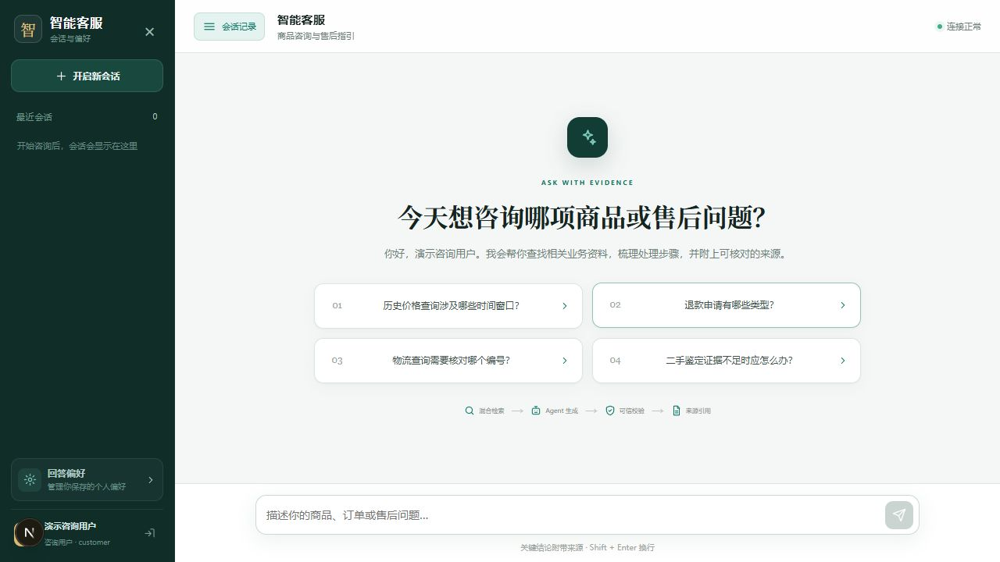
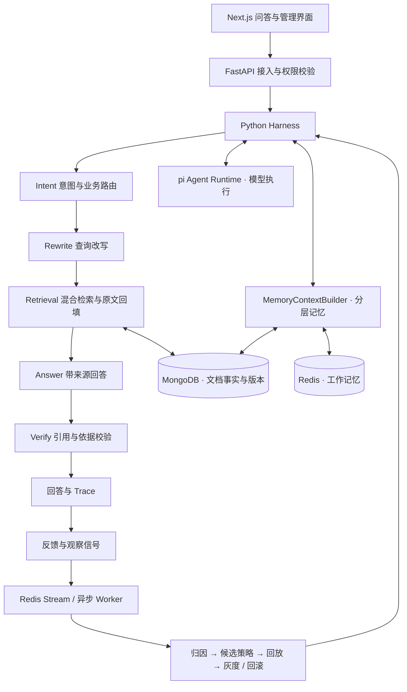

<div align="center">

# 智能客服

**让电商客服回答有据可查，让反馈参与下一轮改进。**

基于可信 RAG、受控 Agent 编排与分层记忆的电商客服知识助手。


[功能特性](#功能特性) · [下载与版本](#下载与版本) · [快速开始](#快速开始) · [系统架构](#系统架构) · [文档](#文档)

</div>

## 项目介绍

智能客服围绕商品咨询、售后规则和订单问题，提供带来源的知识问答与处理指引。用户可以连续追问，管理员可以维护业务文档、审核知识，并通过反馈与策略管理持续调整回答流程。

我开发这个项目，是希望把客服问答中容易出错的环节串成一条可检查的链路：先理解问题，再检索当前有效的资料，依据原文回答，最后校验引用；遇到资料缺失或需要真实业务数据的问题，明确说明依据和能力范围。

仓库包含前端、后端、模型执行服务、示例知识与部署配置，可以在本地体验完整的文本问答流程，也可以作为接入企业知识库和业务工具的开发基础。

## 界面预览



问答工作台支持多轮咨询、会话记录和来源展示；管理端提供文档、业务组、记忆与反馈策略管理。

## 功能特性

| 能力 | 实现方式 |
| --- | --- |
| **带来源的知识问答** | 结合 BM25、向量召回、RRF 与可选重排检索资料，回填有效原文并校验答案引用。 |
| **受控 Agent 流程** | 固定执行 Intent → Rewrite → Retrieval → Answer → Verify，统一处理权限、超时、重试与降级。 |
| **业务知识管理** | 按知识责任组组织文档，维护版本链、生效状态、来源哈希与条款元数据。 |
| **多轮对话与分层记忆** | 区分工作、情景、用户语义、组织知识和程序性策略记忆，按权限、时效与上下文预算装配信息。 |
| **反馈与策略迭代** | 将失败归因为检索、意图、生成或知识缺口，管理 Skill / Hook / Rule 候选，支持回放、灰度与回滚。 |
| **可追踪的执行过程** | 记录 Trace、引用、策略执行和异步作业状态，便于定位问题与复查结果。 |

### 可以咨询什么？

项目内置 7 个知识责任组的流程示例，覆盖以下场景：

| 场景 | 示例问题 |
| --- | --- |
| 商品识别与检索 | “核对同款商品时，需要确认哪些规格信息？” |
| 比价导购 | “历史价格查询涉及哪些时间窗口？” |
| 退款服务 | “仅退款和退货退款有什么区别？” |
| 订单物流 | “物流咨询需要核对哪些编号？” |
| 二手鉴定流程 | “鉴定证据不足时，需要补充哪些材料？” |
| 售后理赔 | “收到破损商品，应先保留哪些凭证？” |
| 图像材料支持 | “提交售后图片时，有哪些清晰度和取证要求？” |

当前版本提供**文本知识咨询与流程指引**。实时查价、订单状态查询、退款提交、商品真伪识别和直接图片问答需要另行接入业务系统或模型能力。示例知识用于开发体验，正式使用时请替换为经过审核的业务资料。

## 下载与版本

- **固定版本**：在 [Releases](https://github.com/yinzuosheng741-wq/intelligent-customer-service/releases) 选择版本，下载页面底部的 `Source code (zip)` 或 `Source code (tar.gz)`。
- **最新源码**：通过 `git clone` 获取，或使用仓库顶部的 **Code → Download ZIP**。

首个版本为 `v0.1.0` 源码预览版，需要安装 Python / Node.js 依赖并配置模型服务。Release 提供固定版本的源码下载，不依赖 Actions 临时产物；当前没有打包为桌面安装程序。

## 快速开始

### 方式一：本地体验

适合先体验界面与问答流程，无需安装 MongoDB 和 Redis。以下命令使用 Windows PowerShell，需要 **Python 3.11+、Node.js 22.19+ 和 npm**。

**1. 获取代码并安装依赖**

```powershell
git clone https://github.com/yinzuosheng741-wq/intelligent-customer-service.git
cd intelligent-customer-service

python -m venv .venv
.\.venv\Scripts\python.exe -m pip install -e .\backend
npm --prefix web ci
npm --prefix services/pi-agent ci
npm --prefix services/pi-agent run build
```

**2. 配置模型**

```powershell
.\.venv\Scripts\python.exe tools/init_env.py
```

编辑生成的 `.env`，填写聊天模型配置：

```dotenv
DEEPSEEK_API_KEY=你的模型密钥
DEEPSEEK_BASE_URL=https://api.deepseek.com
DEEPSEEK_MODEL=你的服务商支持的模型名称
```

初始化脚本会生成本地内部令牌与服务口令，并保留已有 `.env`。使用兼容服务时，请按服务商提供的地址和模型名填写配置。

**3. 启动服务**

```powershell
.\.venv\Scripts\python.exe tools/run_local.py
```

启动器会运行前端、后端与 pi 服务，自动导入 7 份示例知识，并在后端进程内处理异步任务。首次启动请等待知识加载完成。

| 入口 | 地址 |
| --- | --- |
| 客服与管理界面 | [http://127.0.0.1:18080](http://127.0.0.1:18080) |
| API 文档 | [http://127.0.0.1:18000/docs](http://127.0.0.1:18000/docs) |
| pi 健康检查 | [http://127.0.0.1:18100/health](http://127.0.0.1:18100/health) |

| 演示角色 | 用户名 | 密码 |
| --- | --- | --- |
| 咨询用户 | `student` | `student123` |
| 商品组管理员 | `jwc_admin` | `admin123` |
| 系统管理员 | `admin` | `admin123` |

登录后可以先尝试：“收到破损商品，应先保留哪些凭证？”，再追问：“那申请理赔还需要什么材料？”

本地体验模式使用内存保存业务数据，重启后重新初始化。未配置 `RELAY_API_KEY` 时，启动器使用开发用 hash 向量并关闭远程重排；要体验语义向量检索，请配置可用的 Embedding 服务。日志位于 `_runtime/`，停止服务执行：

```powershell
.\.venv\Scripts\python.exe tools/run_local.py --stop
```

### 方式二：Docker Compose

适合使用 MongoDB / Redis 保存文档、会话与作业状态。安装 Docker 和 Compose，获取代码后执行：

```bash
python tools/init_env.py
# 编辑 .env，配置聊天模型与 Embedding / Reranker 服务
docker compose up --build -d
docker compose exec backend python -m scripts.seed_data
docker compose exec backend python -m scripts.ingest_department_files --base /app/department_files
docker compose restart backend
```

仅体验关键词检索和开发用向量时，可在 `.env` 中设置 `EMBEDDING_PROVIDER=hash`、`RERANKER_ENABLED=false`。导入完成后重启后端，使其从持久化文档重建进程内检索索引。访问端口与本地体验模式一致。

审核与反馈的合成演示数据可按需导入：

```bash
docker compose exec backend python -m scripts.seed_demo_data
```

部署到外部环境时，设置 `SEED_DEMO_USERS=false`，配置正式身份、密钥与允许的前端来源。完整参数见 [部署说明](docs/deployment.md) 和 [.env.example](.env.example)。

## 系统架构



### 一次问答如何完成

1. **理解问题**：读取允许访问的会话上下文，识别意图与业务归属，结合术语表补全指代、生成检索查询。
2. **寻找依据**：执行关键词与向量召回，通过 RRF 融合和可选 Reranker 排序，回填原文并检查文档有效状态。
3. **生成与校验**：依据证据生成回答，检查引用和结论；校验失败时按流程重试或降级。
4. **记录与改进**：保存 Trace 和反馈，生成待验证的策略候选，控制后续发布与回滚。

### 关键设计

- **模型推理与流程控制分工**：pi 执行获准阶段的模型任务；Python Harness 管理确定性的执行顺序、权限与失败处理。
- **原文与索引分工**：MongoDB 管理权威文档与状态，向量索引负责候选召回，最终答案以有效原文为依据。当前支持内存、Mongo 和可选 Chroma 向量后端。
- **记忆与事实分工**：历史对话、偏好和摘要用于理解问题，组织知识需绑定并核查原文来源，程序性策略用于调整执行参数。
- **反馈通过策略影响执行**：Skill 可扩展查询词、调整 top-k、切换模板；策略变更保留执行记录，并经过回放与灰度验证。

## 本地开发

完整应用可使用上述本地启动器运行。需要单独开发前端或模型执行服务时，可以在对应目录启动：

```bash
# 前端，默认端口 3000；通过 BACKEND_URL 配置后端地址
cd web
npm run dev
```

```bash
# pi 模型执行服务
cd services/pi-agent
npm run dev
```

单独启动时需为各进程配置环境变量，且避免与本地启动器占用相同端口。后端模块、模型执行协议与环境配置分别见 [后端说明](backend/README.md)、[pi 服务说明](services/pi-agent/README.md) 和 [部署说明](docs/deployment.md)。

当前源码预览版已打通文本问答、来源展示与反馈策略流程；真实业务工具、完整容器部署和集群运行仍需进一步接入与验证。

## 项目结构

```text
backend/             FastAPI、Harness、检索、记忆与 Loop
services/pi-agent/   模型执行与受控工具调用服务
web/                 客服问答与管理界面
department_files/    按业务组组织的示例知识
scenario/            业务组、术语与能力目录
tools/               环境初始化与本地启动
deploy/              Kubernetes / Helm 部署模板
docs/                使用、架构、API 与部署文档
```

## 后续计划

- [ ] 扩充经过审核的商品与售后业务知识。
- [ ] 接入真实 Embedding / Reranker，评估语义检索与引用质量。
- [ ] 对接授权的订单、物流和售后工具，补充调用审计与操作确认。
- [ ] 验证容器部署，补充故障恢复与并发测试。

## 文档

- [架构与执行边界](docs/architecture.md)
- [业务知识设计](docs/business-design.md) · [知识来源](docs/knowledge-sources.md)
- [部署说明](docs/deployment.md) · [API 文档](docs/api.md)
- [反馈与策略 Loop](docs/loop-engineering.md)
- [页面使用指南](docs/user-guide.md)

## 交流与开发参考

欢迎通过 [Issues](https://github.com/yinzuosheng741-wq/intelligent-customer-service/issues) 反馈使用问题或提出改进建议。报告问题时，请附上复现步骤、运行方式与脱敏日志。

本项目基于文枢文档问答工程开展电商场景开发，使用 Pi、FastAPI、Next.js、React 等组件。工程来源与第三方组件说明见 [THIRD_PARTY_NOTICES.md](THIRD_PARTY_NOTICES.md)。
